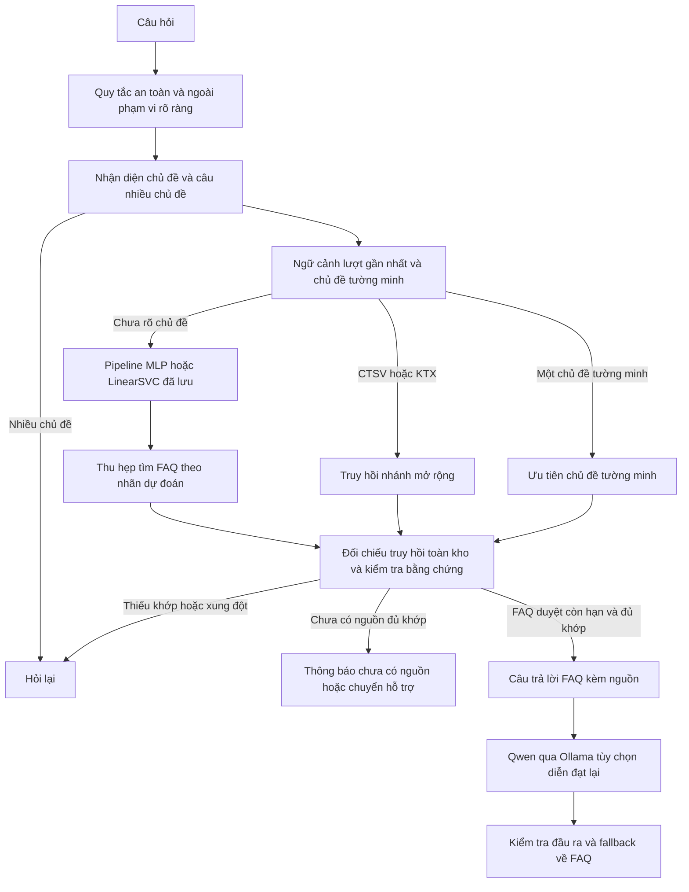

# Bổ sung đối chiếu báo cáo và triển khai HaUI Assist

Đề tài: **Nghiên cứu trí tuệ nhân tạo hội thoại và ứng dụng trong xây dựng chatbot hỗ trợ sinh viên**.

Đây là phần bổ sung cho báo cáo gốc, ghi thực nghiệm và thay đổi trong worktree riêng. Không thay thế tài liệu Word/slide gốc, không triển khai vào dịch vụ đang chạy. Các kết quả dưới đây được lấy từ artifact thực chạy; không suy diễn từ bảng đề xuất trong báo cáo.

## 1. Mục tiêu và liên hệ TC1/TC2

TC1 xây dựng 50 câu minh họa thuộc năm nhãn: học phí, đăng ký học phần, lịch thi, học bổng, điểm học tập. TC2 khảo sát TF-IDF + MLP (ANN một lớp ẩn) và đối chứng LinearSVC. Mục tiêu triển khai là để kết quả phân loại có tác dụng vào bước định hướng tìm FAQ, đồng thời giữ kiểm tra chứng cứ tách khỏi việc đo ý định.

DOCX `sources/Bao_cao_TC1_TC2_Chatbot (1).docx` được lấy làm chuẩn cho dữ liệu, phạm vi năm nhãn, bảng TF-IDF 1.6, ánh xạ nhãn 1.7, MLP 1.8, lưới cấu hình 1.11 và phương pháp đánh giá. Slide còn có nhãn học vụ/CTSV/KTX, mức trần 5000, mạng 64/128 neuron, Adam và GridSearchCV ba fold ở mức đề xuất. Phiên này không dùng các đề xuất đó để thay đổi TC1/TC2. CTSV/KTX là chức năng mở rộng truy hồi, không phải hai nhãn huấn luyện mới. BiLSTM/PhoBERT chưa chạy.

| Nội dung | Mã/artifact kiểm chứng |
| --- | --- |
| TC1: nguyên văn, nhãn, chia tập | `data/original_50.csv`; test đối chiếu từng hàng với bảng phụ lục DOCX |
| Chuẩn hóa có dấu cho phân loại | `app/text.py::normalize_classification`, lưu callable trong pipeline |
| TC2: TF-IDF + MLP/LinearSVC | `scripts/train.py`, `models/mlp.joblib`, `models/linearsvc.joblib` |
| Chốt cấu hình trước bước Test | `reports/selection.json`, dấu thời gian trong `reports/experiments.json` |
| Nhãn tác động tìm FAQ | `app/engine.py::Engine.route`, `Engine.classify`, `Engine.search` |
| So sánh chế độ, không thay giao diện sinh viên | `POST /api/experiments/route`, `app/static/app.js::loadExperiments` |
| Chọn FAQ được đánh giá riêng | `scripts/evaluate_faq.py`, `data/technical_faq_cases.json`, `reports/faq-evaluation.json` |
| Hồi quy và kiểm tra sandbox | `tests/test_research_routing.py`, `scripts/check_alignment_inprocess.py`, `scripts/check_alignment_ui.js` |

Các hash gốc trong `reports/source-files.sha256` vẫn khớp cả DOCX và PPTX. Kiểm thử đọc XML bảng phụ lục và so sánh đủ 50 câu, nhãn, cách chia với CSV. Không chạy `prepare_data.py`, không lấy diễn đạt lại của Test vào Train/Validation, không truy cập SQLite hội thoại hoặc cấu hình riêng tư.

## 2. Phương pháp và tính minh bạch của Test

**Đây là tái thực nghiệm trên tập Test đã từng được xem trong lần triển khai trước, không phải đánh giá độc lập mới.** Ghi lựa chọn trước khi tính Test trong lần chạy này giúp lưu vết quy trình; nó không làm Test trở lại trạng thái chưa từng được biết.

Giữ 30 Train / 10 Validation / 10 Test, lần lượt 6/2/2 câu mỗi nhãn. Mỗi câu gốc là một group_id riêng. Không tăng dữ liệu, đổi nhãn hay đổi tập để nâng điểm. Không có nguồn/quy trình thu thập hợp lệ cho một tập phản hồi sinh viên mới, nên không tạo tập thực tế mới. Các câu kiểm tra kỹ thuật ở phần 6 chỉ là tình huống tự biên soạn.

Chuẩn hóa phân loại: NFC, chữ thường, gom khoảng trắng, giữ dấu và các từ “không”, “chưa”, “được”; không bỏ stopword, không tách từ bằng VnCoreNLP và không mở rộng viết tắt trong thí nghiệm. Tokenizer word mặc định của sklearn với n-gram (1,2) biểu diễn từ/cặp token, chưa phải bộ tách từ ghép tiếng Việt. Chuẩn hóa truy hồi là hàm riêng: thêm từ điển viết tắt, bỏ dấu và dấu câu để hỗ trợ câu không dấu. Việc bỏ dấu không được dùng cho huấn luyện/phân loại.

TF-IDF: analyzer=word, ngram_range=(1,2), max_features=500, min_df=1, strip_accents=None, sublinear_tf=True, norm=l2. Mỗi ứng viên nằm trong Pipeline; TF-IDF chỉ fit trên 30 Train. Validation/Test chỉ transform/predict. Không refit Train+Validation sau khi chọn. Có **327 đặc trưng thực tế**, không mặc định 500 chiều. Nhãn trong sklearn là chuỗi; thứ tự lớp xuất điểm lưu theo `classes_`, thứ tự bảng/ma trận theo Bảng 1.7 DOCX. Không nhầm hai thứ tự này.

MLP: ReLU, hidden_layer_sizes=(16,) hoặc (32,), alpha=0.001/0.01, solver=lbfgs, max_iter=1000, tol=0.0001, random_state=42. LinearSVC: C=0.1/1.0, random_state=42. Chọn mỗi họ theo Macro-F1 Validation; hòa trong họ lấy cấu hình xuất hiện đầu (16 trước 32, alpha 0.001 trước 0.01; C=0.1 trước 1.0). Chọn mô hình ứng dụng theo điểm Validation; hòa ưu tiên LinearSVC vì cấu trúc suy luận tuyến tính đơn giản. Đây là quy tắc triển khai, không phải kết luận MLP kém hơn.

MLP giữ vai trò nghiên cứu chính kể cả khi ứng dụng chọn đối chứng. Pipeline, đầy đủ tham số classifier, seed, dữ liệu/hash, phiên bản thư viện, số đặc trưng, nhãn, số vòng lặp và cảnh báo hội tụ được lưu đồng bộ trong metadata joblib và JSON. Các dự đoán từng câu Train/Validation/Test đều được lưu. Confusion matrix và chỉ số từng lớp có trong các kết quả tập, không chỉ số tổng hợp.

## 3. Kết quả phân loại thực chạy
Thời điểm chạy UTC: `2026-10-21T05:10:29.990534+00:00`. Phiên bản dữ liệu: `TC1-original-50-fixed-split`; SHA-256 CSV: `4f1dd703b699bd79bf752035b83b981fb0087590c4a405bbc6d9ab0b1f30650b`.

| Mô hình | Cấu hình khảo sát | Macro-F1 Validation | Vòng lặp | Cảnh báo hội tụ |
| --- | --- | ---: | ---: | --- |
| MLP | `{"hidden_layer_sizes": [16], "alpha": 0.001}` | 1.0000 | 29 | Không |
| MLP | `{"hidden_layer_sizes": [16], "alpha": 0.01}` | 1.0000 | 42 | Không |
| MLP | `{"hidden_layer_sizes": [32], "alpha": 0.001}` | 1.0000 | 29 | Không |
| MLP | `{"hidden_layer_sizes": [32], "alpha": 0.01}` | 1.0000 | 39 | Không |
| LinearSVC | `{"C": 0.1}` | 1.0000 | 10 | Không |
| LinearSVC | `{"C": 1.0}` | 1.0000 | 19 | Không |

Chốt lựa chọn: `2026-10-21T05:10:30.083280+00:00`; bắt đầu tính Test: `2026-10-21T05:10:30.083477+00:00`. Hai họ hòa Validation 1,0, do đó chọn **LinearSVC** mặc định. `test_previously_seen=true` trong selection giải thích lịch sử của Test; `test_evaluated_in_this_run=false` là trạng thái tại thời điểm chốt, không có nghĩa chưa từng xem Test.

| Mô hình | Cấu hình chọn | Accuracy Train | Macro-F1 Validation | Accuracy Test | Macro-F1 Test | Fit (s) | p50 / p95 (ms) |
| --- | --- | ---: | ---: | ---: | ---: | ---: | ---: |
| MLP | `{"hidden_layer_sizes": [16], "alpha": 0.001}` | 1.0000 | 1.0000 | 0.7000 | 0.7133 | 0.012967 | 0.341 / 0.366 |
| LinearSVC | `{"C": 0.1}` | 1.0000 | 1.0000 | 0.7000 | 0.6933 | 0.001617 | 0.295 / 0.313 |

Độ trễ đo pipeline phân loại, batch=1, lặp 10 lần qua 10 câu Test (100 phép đo/mô hình), không gồm HTTP, truy hồi hoặc Qwen. Không phải benchmark tải hệ thống. Train đạt 1,0 không chứng minh khái quát tốt; khoảng cách Test cho thấy cần dữ liệu độc lập lớn hơn. MLP có Macro-F1 Test nhỉnh hơn trong lần đo này, nhưng Test chỉ 10 câu và đã được xem, nên chưa đủ cơ sở kết luận ưu thế mô hình.

### Chỉ số từng nhãn trên Test

| Mô hình | Nhãn | Precision | Recall | F1 | Support |
| --- | --- | ---: | ---: | ---: | ---: |
| MLP | Học phí | 0.5000 | 0.5000 | 0.5000 | 2 |
| MLP | Đăng ký học phần | 1.0000 | 1.0000 | 1.0000 | 2 |
| MLP | Lịch thi | 0.3333 | 0.5000 | 0.4000 | 2 |
| MLP | Học bổng | 1.0000 | 1.0000 | 1.0000 | 2 |
| MLP | Điểm học tập | 1.0000 | 0.5000 | 0.6667 | 2 |
| LinearSVC | Học phí | 0.5000 | 0.5000 | 0.5000 | 2 |
| LinearSVC | Đăng ký học phần | 0.6667 | 1.0000 | 0.8000 | 2 |
| LinearSVC | Lịch thi | 0.5000 | 0.5000 | 0.5000 | 2 |
| LinearSVC | Học bổng | 1.0000 | 1.0000 | 1.0000 | 2 |
| LinearSVC | Điểm học tập | 1.0000 | 0.5000 | 0.6667 | 2 |

### Confusion matrix

Hàng là thực, cột là dự đoán. HP=học phí; ĐK=đăng ký học phần; LT=lịch thi; HB=học bổng; ĐT=điểm học tập.

**MLP**

| Thực \ Dự đoán | HP | ĐK | LT | HB | ĐT |
| --- | ---: | ---: | ---: | ---: | ---: |
| HP | 1 | 0 | 1 | 0 | 0 |
| ĐK | 0 | 2 | 0 | 0 | 0 |
| LT | 1 | 0 | 1 | 0 | 0 |
| HB | 0 | 0 | 0 | 2 | 0 |
| ĐT | 0 | 0 | 1 | 0 | 1 |

**LinearSVC**

| Thực \ Dự đoán | HP | ĐK | LT | HB | ĐT |
| --- | ---: | ---: | ---: | ---: | ---: |
| HP | 1 | 1 | 0 | 0 | 0 |
| ĐK | 0 | 2 | 0 | 0 | 0 |
| LT | 1 | 0 | 1 | 0 | 0 |
| HB | 0 | 0 | 0 | 2 | 0 |
| ĐT | 0 | 0 | 1 | 0 | 1 |

### Lỗi phân loại giữ nguyên trong báo cáo

| Mô hình | Câu | Nhãn thực | Nhãn dự đoán |
| --- | --- | --- | --- |
| MLP | Q010: Làm sao để lấy thông tin các khoản phải nộp của học kỳ? | hoc_phi | lich_thi |
| MLP | Q029: Làm thế nào để kiểm tra địa điểm thi? | lich_thi | hoc_phi |
| MLP | Q050: Làm sao để biết mình đã có kết quả thi cuối kỳ? | diem_hoc_tap | lich_thi |
| LinearSVC | Q010: Làm sao để lấy thông tin các khoản phải nộp của học kỳ? | hoc_phi | dang_ky_hoc_phan |
| LinearSVC | Q029: Làm thế nào để kiểm tra địa điểm thi? | lich_thi | hoc_phi |
| LinearSVC | Q050: Làm sao để biết mình đã có kết quả thi cuối kỳ? | diem_hoc_tap | lich_thi |

Q010 thiếu cụm “học phí” rõ ràng nên hai họ nhầm sang nhãn khác nhau; Q029 nói “địa điểm thi” nhưng bị dự đoán học phí; Q050 “kết quả thi cuối kỳ” bị nhầm lịch thi. Đây là diễn giải quan sát lỗi, không phải phân tích nhân quả hay căn cứ sửa nhãn. Trong ứng dụng, quy tắc tường minh có thể cứu một số trường hợp; kết quả ứng dụng không được thay vào bảng phân loại thuần.

## 4. Kiến trúc định hướng FAQ cuối cùng



Thứ tự ưu tiên được cố định:

1. Chào hỏi, chặn yêu cầu vượt quyền và một số chủ đề ngoài phạm vi rõ ràng; không chạy classifier để ép câu này vào năm lớp.
2. Nếu phát hiện nhiều chủ đề, hỏi chọn nội dung trước. Không dùng điểm tối đa của mô hình để bỏ qua tính nhiều ý định.
3. Câu hỏi ngắn có dấu hiệu tiếp nối chỉ lấy ngữ cảnh từ câu trả lời gần nhất có chủ đề. Không lấy lại chủ đề cũ xuyên qua lượt chào hỏi, hỏi lại hoặc từ chối. CTSV/KTX tiếp nối vẫn là mở rộng.
4. CTSV/KTX tường minh bỏ qua bộ phân loại năm lớp. Trường hợp truy hồi toàn kho tìm được FAQ mở rộng đủ khớp dù thiếu mẫu từ khóa thì giữ nhánh mở rộng. Không có dữ liệu CTSV/KTX trong huấn luyện năm lớp.
5. Trong miền nghiên cứu, dùng classifier trên câu gốc có dấu. Nếu thiếu chủ đề tường minh, tìm FAQ có `intent` bằng nhãn dự đoán. Nhãn thực sự ảnh hưởng danh sách ứng viên; kiểm thử đổi nhãn giả sang học bổng làm câu chuyển khoản không còn được trả lời bằng FAQ học phí. Nếu nhãn xung đột với chủ đề tường minh thì chủ đề tường minh ưu tiên, ghi `explicit_overrides_classifier`. Nếu hai bên đồng ý, trace ghi `classifier_agrees`, nhưng `classifier_used=false` vì quy tắc tường minh đã quyết định nhóm tìm kiếm.
6. So sánh với truy hồi toàn kho, kiểm tra độ khớp riêng trước khi chọn câu trả lời. Mô hình sai nhóm không được dùng làm bằng chứng để trả lời. Thiếu pipeline thì dùng quy tắc/truy hồi; endpoint nghiên cứu yêu cầu rõ một pipeline chưa có sẽ trả 503.

`routing` và `classification` cho phép quan sát câu nào thực sự dùng nhãn; không chỉ đính kèm nhãn sau khi đã trả lời. Chế độ `retrieval` loại riêng bước dự đoán để tạo mốc kỹ thuật nhưng vẫn giữ các quy tắc an toàn. Mỗi lượt thử ở trang Thực nghiệm có chế độ riêng, không sửa cấu hình toàn cục hay hội thoại sinh viên. Chat thông thường dùng `auto` theo lựa chọn Validation.

## 5. Chứng cứ, điểm số và hỏi lại

| Giá trị | Ý nghĩa | Điều không được suy ra |
| --- | --- | --- |
| `retrieval_score` | Kết hợp cosine TF-IDF word/char sau chuẩn hóa không dấu | Không phải xác suất FAQ đúng |
| MLP `predict_proba` | Phân bố softmax trên năm lớp đã huấn luyện | Chưa hiệu chỉnh, không chứng minh câu trong miền hoặc FAQ đúng |
| LinearSVC `decision_function` | Điểm quyết định tuyến tính theo từng lớp | Không phải xác suất và không dùng cùng ngưỡng số với softmax |

Không đặt ngưỡng chấp nhận dựa trên điểm phân loại vì chưa có tập hiệu chỉnh/OOD độc lập. Truy hồi dùng ngưỡng kỹ thuật có sẵn 0,30 nếu chưa rõ chủ đề, 0,13 nếu có chủ đề; thêm chênh lệch 0,025 để hỏi lại khi các chủ đề sát điểm hoặc nhóm classifier mâu thuẫn ứng viên toàn kho. Kiểm tra từ vựng bổ sung bỏ nhóm từ chức năng/từ chỉ chủ đề; nếu còn ít nhất hai từ thì cần ít nhất 25% từ xuất hiện trong văn bản FAQ. Năm 20xx được hỏi phải có trong FAQ. Đây là quy tắc bảo thủ để giảm trả lời chỉ nhờ trùng từ chủ đề, chưa phải ngưỡng tối ưu hay mô hình phát hiện ngoài miền. Nó có thể từ chối nhầm câu hợp lệ và chưa bảo đảm phát hiện mọi câu không liên quan.

Ví dụ “Học phí thiên văn sao hỏa lượng tử” từng vượt ngưỡng cosine chỉ nhờ cụm học phí. Sau bổ sung kiểm tra từ vựng, hệ thống hỏi lại và không gắn nguồn như thể đã trả lời được. “Học phí năm 2099” cũng hỏi lại khi kho chưa có năm này. “Em cần đóng tiền không?” thiếu loại khoản tiền được hỏi rõ. Khi không có FAQ đủ điểm, `out_of_scope` kèm `fallback_reason=insufficient_retrieval_evidence` có nghĩa chưa có chứng cứ đủ khớp, không chứng minh đầu vào thực sự ngoài miền. Câu nhiều chủ đề và xung đột chứng cứ dùng `clarify`.

Nguồn phải được duyệt và còn hạn dùng; ngày `valid_until` là mốc rà soát nội bộ. Nhãn và câu minh họa không tạo ra quy định học phí/học bổng. Hệ thống chưa kết nối công nợ, điểm, lịch thi cá nhân hay phòng trống; FAQ hướng dẫn tra cứu phải nói rõ giới hạn này. Kho FAQ còn có thể chọn sai hướng dẫn trong cùng chủ đề.

Qwen3 qua Ollama là mô hình có sẵn. Chỉ sau khi chọn FAQ có chứng cứ, ứng dụng mới có thể nhờ mô hình diễn đạt lại. Không huấn luyện Qwen bằng bộ 50 câu, không dùng Qwen thay cho MLP/LinearSVC và không đo chất lượng Qwen bằng Accuracy phân loại. Trong phiên này không gọi provider hay tải mô hình. Các kiểm tra sinh văn bản dùng mock để xác nhận fallback khi thêm số liệu không có trong nguồn; cơ chế kiểm tra chưa chứng minh mọi câu sinh đều đúng ngữ nghĩa.

## 6. Đánh giá chọn FAQ tách khỏi phân loại ý định

`data/technical_faq_cases.json` chứa 20 tình huống kỹ thuật, được người triển khai tự biên soạn từ yêu cầu và chức năng kho FAQ; 13 tình huống dự kiến chọn FAQ, 7 tình huống kiểm tra hỏi lại/từ chối. Có ID FAQ chấp nhận hoặc status mong đợi, gồm không dấu, thiếu từ khóa, mở rộng, tiếp nối, nhiều chủ đề, thiếu năm học, câu không liên quan và yêu cầu vượt quyền. Không gọi đây là phản hồi sinh viên thực tế, tập OOD độc lập hay dữ liệu mới để kết luận khả năng khái quát. Không dùng tập này để chọn cấu hình phân loại hoặc báo ngưỡng tối ưu.

Mỗi chế độ chạy trên đúng cùng tình huống và kho FAQ công khai. Chọn đúng FAQ: status answered và ID trong danh sách chấp nhận. Tỷ lệ đúng trên tình huống cần FAQ tính cả hỏi lại/từ chối là chưa đúng. Độ đúng trong câu đã trả lời tính trên toàn bộ câu mà chế độ trả lời. Đúng hành vi gồm đúng status; nếu answered còn phải đúng ID. Trạng thái out_of_scope gồm cả chưa đủ nguồn và từ chối rõ ràng; không gộp thành tỷ lệ nhận diện ngoài miền.

| Chế độ | Đúng FAQ / cần FAQ | Đúng FAQ / đã trả lời | Đúng hành vi / tổng | Hỏi lại | Chưa nguồn/từ chối |
| --- | ---: | ---: | ---: | ---: | ---: |
| auto | 9/13 (69.23%) | 9/11 (81.82%) | 16/20 | 5 | 4 |
| mlp | 9/13 (69.23%) | 9/11 (81.82%) | 16/20 | 5 | 4 |
| linearsvc | 9/13 (69.23%) | 9/11 (81.82%) | 16/20 | 5 | 4 |
| retrieval | 10/13 (76.92%) | 10/12 (83.33%) | 17/20 | 5 | 3 |

Hai mô hình không cải thiện trên mọi tình huống. Chỉ truy hồi tốt hơn một tình huống trong bộ kiểm tra kỹ thuật này; không suy ra mô hình nào sẽ thắng trên lưu lượng thực tế. Các câu có chủ đề tường minh thường dùng cùng nhóm FAQ nên MLP/LinearSVC có thể cho cùng đầu ra dù điểm phân loại khác.

### Ví dụ và lỗi đầu cuối thực tế của lần chạy

| Tình huống | Quan sát thật | Ý nghĩa |
| --- | --- | --- |
| T06: “Em đã chuyển khoản mà hệ thống vẫn chưa ghi nhận” | Hai mô hình dự đoán học phí, nhãn dùng để tìm trong học phí, chọn FAQ-004, score=0,4715 | Ví dụ nhãn thực sự tác động truy hồi; vẫn cần kiểm tra FAQ riêng |
| “Xem công nợ ở đâu?” (hồi quy) | Hai mô hình nhầm điểm học tập; quy tắc công nợ giữ học phí, chọn FAQ-002 | Phân loại sai không được đè chủ đề tường minh |
| T03: “Em xem lịch thi ở đâu” | Cả bốn chế độ chọn FAQ-011 (xử lý trùng/đổi lịch), mong đợi FAQ-010 (tra cứu lịch/ca/phòng) | Đúng ý định chưa đủ để chọn đúng FAQ trong nhóm |
| T07: “Em xem kết quả của từng môn ở đâu?” | MLP dự đoán học bổng, LinearSVC dự đoán lịch thi; cả hai không trả lời vì thiếu khớp trong nhóm. Chỉ truy hồi chọn FAQ-017, score=0,3008 | Thu hẹp theo nhãn sai làm mất FAQ đúng; cơ chế bảo thủ giảm trả lời nhưng giảm độ bao phủ |
| T08: “Em muốn đăng ký ktx” | Bỏ qua classifier; chọn FAQ-024 (lịch đăng ký), mong đợi FAQ-022 (hướng dẫn trực tuyến) | Mở rộng vẫn có lỗi truy hồi trong chủ đề; không phải lỗi nhãn năm lớp |
| T18: “Em có thể kiểm tra các môn đã chọn ở đâu?” | MLP dự đoán đăng ký học phần, LinearSVC dự đoán điểm; mọi chế độ chưa vượt ngưỡng, không chọn FAQ-009 mong đợi | Truy hồi thiếu từ khóa và dữ liệu nhỏ còn hạn chế, kể cả khi một classifier đúng ý định |
| T11/T20: “Vậy hồ sơ cần gì?” | Có ngữ cảnh học bổng: FAQ-015; không ngữ cảnh: hỏi lại | Tách ngữ cảnh tiếp nối khỏi dự đoán độc lập trên câu thiếu nghĩa |

Các lỗi trên là giới hạn chất lượng đã đo và được lưu nguyên trạng trong `reports/faq-evaluation.json`. Không sửa nhãn/cách chia để tăng điểm hoặc chuyển sai FAQ thành “đúng” chỉ vì cùng nhãn. Không có phép đo mới về câu trả lời sinh văn bản với người dùng thật.

## 7. Kiểm chứng và giới hạn môi trường

- Chạy huấn luyện thật bằng `.venv/bin/python scripts/train.py`, sau đó `scripts/evaluate_faq.py`. Không cài/xóa/nâng cấp gói trong `.venv` liên kết.
- Kiểm tra tính toán/hồi quy không dùng `client`/`logged`: **41 passed**. Bao gồm chuẩn hóa dấu/Unicode/phủ định, feature vocabulary/IDF chỉ học Train, hash và metadata pipeline, đối chiếu 50 câu với DOCX, chuyển mô hình/ý nghĩa điểm, nhãn thực sự giới hạn tìm FAQ, nguồn thiếu, chủ đề mở rộng, tiếp nối và ưu tiên an toàn.
- Kiểm tra API bằng `httpx.ASGITransport` trong tiến trình: **9 nhóm đạt**, có DB/tài khoản giả lập trong thư mục tạm, AI tắt, không network. Kiểm tra API nghiên cứu không ghi lịch sử/không đổi mặc định, nguồn trả lời chat, validation/CORS, FAQ nháp/duyệt và phục vụ HTML/JS. Đây là bổ sung cho full pytest, không thay thế nó.
- `node --check app/static/app.js` đạt. Kiểm tra renderer bằng Node VM/DOM giả lập: **6 nhóm đạt**, gồm cảnh báo Test cũ, số đặc trưng thật, hai confusion matrix, chế độ nghiên cứu, bảng chọn FAQ tách riêng, submit theo mô hình và escape nội dung. DOM giả lập không kiểm tra bố cục hoặc tương tác trình duyệt đầy đủ.
- Đã chạy đúng `timeout 120 .venv/bin/python -m pytest tests -q`; trong sandbox, 22 kiểm tra đầu qua rồi treo ở khởi tạo `TestClient`, hết 120 giây (exit 124). Ứng dụng FastAPI tối giản cũng tái hiện treo tại Starlette/AnyIO portal, trước khi gọi endpoint. Socket AF_INET bị từ chối với `PermissionError: [Errno 1] Operation not permitted`; chưa kết luận socket là nguyên nhân duy nhất của portal treo. Script host cần chạy lại full suite, không được coi log partial là full pytest đạt.
- Thử Chromium headless có sandbox bật: không khởi động được, `sandbox_host_linux.cc:41 ... shutdown: Operation not permitted`. Không hạ sandbox hay yêu cầu quyền lại. Chưa kiểm chứng bố cục desktop/mobile hiện tại; ảnh/báo cáo browser cũ không phải bằng chứng của phiên này.

Artifact kiểm chứng phiên này: `reports/report-alignment-pytest.txt`, `reports/report-alignment-pytest-compute.txt`, `reports/report-alignment-inprocess.json`, `reports/report-alignment-ui.json`, `reports/report-alignment-verification.json`. Các file `reports/pytest.txt` và ảnh triển khai cũ được giữ làm lịch sử.

## 8. Giới hạn và hướng phát triển

Dữ liệu 50 câu minh họa, Test 10 câu đã được xem, cùng Validation nhỏ hạn chế khả năng kết luận. Validation đạt tuyệt đối trên lưới nhỏ chưa chứng minh mô hình ổn định. Chuẩn hóa không dấu chỉ hỗ trợ truy hồi; classifier có dấu chưa được huấn luyện bằng biến thể lỗi gõ/không dấu. Quy tắc chủ đề và từ vựng có thể bỏ sót ý định, từ chối nhầm hoặc chấp nhận nhầm. Việc thu hẹp nhãn sai có thể làm mất FAQ đúng. Kho 25 FAQ mới chỉ hướng dẫn một số thông tin và không có dữ liệu cá nhân.

Bước tiếp theo cần một quy trình thu thập có nguồn, đồng thuận/quyền sử dụng, ẩn dữ liệu cá nhân, nhãn và FAQ ID được rà soát, nhóm theo hội thoại/người hỏi/câu gần trùng, tập chốt độc lập gồm trong miền/ngoài miền/nhiều chủ đề. Khi đủ dữ liệu mới chọn/đánh giá ngưỡng truy hồi, hiệu chuẩn điểm, đo tỷ lệ hỏi lại/từ chối và chất lượng thực tế. Có thể khảo sát soft routing hoặc kết hợp nhãn–truy hồi để giảm mất FAQ khi classifier sai; mọi thay đổi phải được đánh giá tách biệt. BiLSTM/PhoBERT, sentence embeddings và hội thoại nhiều lượt đầy đủ vẫn là hướng phát triển, chưa có kết quả trong báo cáo này.

## 9. Gợi ý trình bày khi bảo vệ

1. Mở từ TC1: xác nhận 50 câu tự biên soạn, năm nhãn và chia 30/10/10; nói ngay Test đã từng được xem, đây là tái thực nghiệm.
2. Trình bày TC2: TF-IDF giữ dấu, Train-only, 327 chiều thực tế dưới trần 500; MLP nhỏ 16/32 neuron, đối chứng tuyến tính cùng điều kiện. Giải thích L-BFGS theo vòng lặp, không gọi epoch Adam.
3. Cho xem bảng mọi ứng viên Validation và `selection.json` trước khi nêu Test. MLP là nghiên cứu chính, LinearSVC được chọn mặc định do quy tắc hòa. Không nói MLP thắng vì mục tiêu dùng ANN.
4. Demo trang Thực nghiệm với T06, đổi MLP/LinearSVC/chỉ truy hồi và giải thích `classifier_used`, `predict_proba`, `decision_function`, `retrieval_score`. Giữ chi tiết này ở phần nghiên cứu, không thêm lựa chọn mô hình vào chat sinh viên.
5. Demo KTX/CTSV, hai chủ đề, thiếu nguồn/năm học và hỏi tiếp nối. Chỉ ra nhãn không chứng minh FAQ đúng; Qwen chỉ diễn đạt nội dung FAQ được chọn.
6. Trình bày T03 và T07 như lỗi thật: đúng ý định chưa đủ đúng FAQ; nhãn sai có thể giảm độ bao phủ. Nêu bảng 9/13 so với 10/13 chỉ là kiểm tra kỹ thuật, chưa đánh giá với sinh viên thật.
7. Kết thúc phần đánh giá bằng nhu cầu dữ liệu độc lập và kiểm chứng host; BiLSTM/PhoBERT chưa chạy. Không dùng ảnh browser cũ để nhận đã kiểm chứng giao diện mới.

## 10. Tái lập trong checkout riêng

```bash
.venv/bin/python scripts/train.py
.venv/bin/python scripts/evaluate_faq.py
timeout 120 .venv/bin/python -m pytest tests -q
timeout 60 .venv/bin/python scripts/check_alignment_inprocess.py
node --check app/static/app.js
node scripts/check_alignment_ui.js
```

Không chạy script reset tài khoản, chuẩn bị lại dữ liệu đã biên tập, sao lưu/khôi phục hoặc dịch vụ systemd cho phần nghiên cứu này. Không push, merge, deploy hay tự commit. Marker `reports/report-alignment-ready.txt` chỉ báo sẵn sàng cho host kiểm tra cuối. Host chỉ tạo marker complete và commit khi full pytest đạt; ready không phải xác nhận full suite hoặc nghiệm thu cuối.

Môi trường lần chạy: python=3.12.14, sklearn=1.9.1, numpy=2.5.4, scipy=1.18.1, joblib=1.6.0.

## 11. Kiểm chứng bổ sung trước khi đưa vào main

Lần kiểm chứng UTC 2026-10-21T17:23:44.690483+00:00: toàn bộ pytest đạt **54 passed** (exit 0), kiểm tra cú pháp JavaScript đạt và kiểm tra renderer bằng Node đạt **6 nhóm**. Các lỗi môi trường ở mục 7 là lịch sử của phiên trước; không còn chặn pytest trong lần này. Chưa kiểm tra bố cục bằng trình duyệt.
